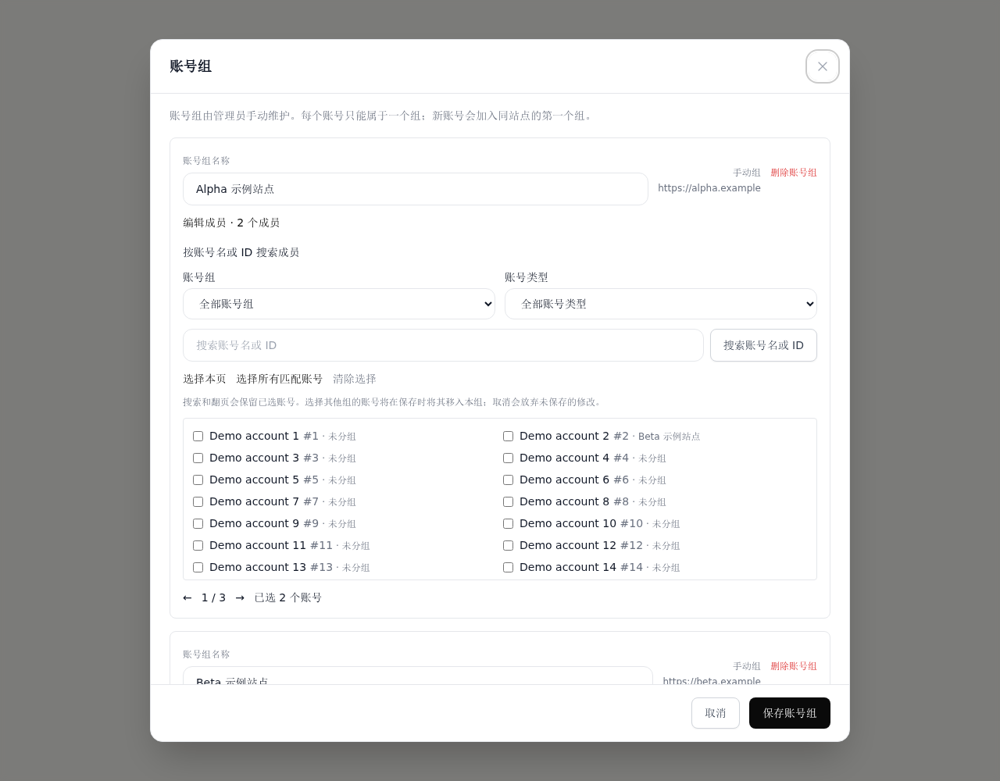
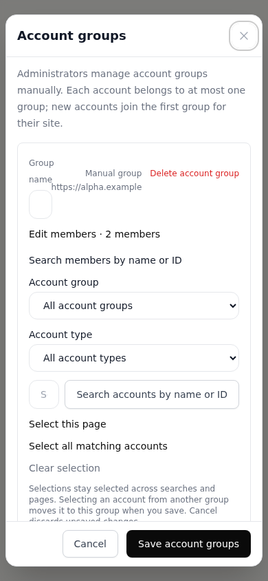

# 账号运维组成员选择器视觉与交互复核

<!-- visual-review-manifest
{
  "schema_version": 1,
  "changed_files": [
    "frontend/src/components/admin/operations/AccountOpsGroupDialog.vue",
    "frontend/src/components/admin/operations/QualityAccountSelector.vue",
    "frontend/src/i18n/locales/en/accountOps.ts",
    "frontend/src/i18n/locales/zh/accountOps.ts",
    "frontend/src/views/admin/AccountOpsView.vue"
  ],
  "routes_or_surfaces": ["/admin/account-ops — account-group membership dialog", "/admin/account-quality — shared account selector"],
  "languages_and_themes": ["zh/light", "en/light", "zh/dark", "en/dark"],
  "states": ["initial group members", "name and ID search", "group and account-type filtering", "pagination", "selection retained across pages and filters", "move member across groups", "retain hidden or unavailable IDs", "selection limit", "saving and disabled controls", "cancel without write", "existing selector disabled-reason contract", "keyboard navigation"],
  "viewports": ["390x844", "768x1024", "1280x1000", "1920x1080"],
  "artifact_mode": "browser-capture",
  "prototype_artifacts": ["docs/visual-reviews/assets/2026-11-26-account-ops-group-selector/prototype-1280.png", "docs/visual-reviews/assets/2026-11-26-account-ops-group-selector/prototype-390.png"],
  "baseline_artifacts": ["docs/visual-reviews/assets/2026-11-26-account-ops-group-selector/before-desktop-zh.png", "docs/visual-reviews/assets/2026-11-26-account-ops-group-selector/before-mobile-en.png"],
  "updated_artifacts": ["docs/visual-reviews/assets/2026-11-26-account-ops-group-selector/after-desktop-zh.png", "docs/visual-reviews/assets/2026-11-26-account-ops-group-selector/after-desktop-en.png", "docs/visual-reviews/assets/2026-11-26-account-ops-group-selector/after-mobile-en-overview.png", "docs/visual-reviews/assets/2026-11-26-account-ops-group-selector/after-mobile-zh-dark.png", "docs/visual-reviews/assets/2026-11-26-account-ops-group-selector/after-tablet-zh.png", "docs/visual-reviews/assets/2026-11-26-account-ops-group-selector/after-wide-en.png", "docs/visual-reviews/assets/2026-11-26-account-ops-group-selector/quality-existing-disabled-contract.png"],
  "commands": ["node .github/scripts/account-ops-selector-preview.mjs (Playwright Chromium, real components and locales; synthetic data and offline API only)", "pnpm --dir frontend exec vitest run src/components/admin/operations/__tests__/QualityAccountSelector.spec.ts src/components/admin/operations/__tests__/AccountOpsGroupSelector.spec.ts src/i18n/__tests__/localeKeyCompleteness.spec.ts"],
  "checks": {
    "keyboard": {"status": "passed", "notes": "Playwright verifies Tab/Enter/Space/Escape; component tests verify Enter search, page traversal, selection retention, and busy-save fencing."},
    "reduced_motion": {"status": "not-applicable", "reason": "This change adds no animation or motion-dependent behavior."}
  },
  "residual_risks": ["Browser evidence uses synthetic account/group data and an offline API adapter; deployed administrator, ordinary-user and guest acceptance is still required."]
}
-->

## Scope

- Routes: `/admin/account-ops`; shared picker is also used by `/admin/account-quality`.
- Roles: administrator only; account membership edits use the existing admin API.
- Languages/themes: Chinese and English, light and dark.

## Baseline

- Existing selector behavior and visual baseline are captured in `assets/2026-11-26-account-ops-group-selector/before-desktop-zh.png` and `before-mobile-en.png`.
- Baseline exposed unresolved selector labels; updated locale coverage was verified in the browser run.

## Prototype

- Prototype boards: `assets/2026-11-26-account-ops-group-selector/prototype-1280.png` and `prototype-390.png`.
- The proposal keeps the picker inside the existing dialog and adds filtering, search, and pagination without changing API semantics.

## Reuse Decision

- Reused `QualityAccountSelector`, `BaseDialog`, existing Tailwind tokens and locale loading scopes.
- Kept membership ownership and persistence in `AccountOpsGroupDialog`; the selector remains shared with existing account-quality workflows.
- No design-system exception.

## State Coverage

- Covered search by account name/ID, group/type filters, pagination, cross-page selection, hidden IDs, cross-group moves, selection limit, save-disabled state, cancellation, keyboard operation, and existing disabled-reason behavior.
- Browser assertions verify all visible selector strings resolve in both locales.

## Viewport Coverage

- Mobile `390x844`, tablet `768x1024`, desktop `1280x1000`, and wide `1920x1080`.
- Assertions verify no horizontal overflow; mobile controls were reached through natural dialog scrolling and center hit-tests.
- Reduced-motion behavior is not applicable because this change adds no animations.

## Evidence

- Updated captures: `assets/2026-11-26-account-ops-group-selector/after-desktop-zh.png`, `after-desktop-en.png`, `after-mobile-en-overview.png`, `after-mobile-zh-dark.png`, `after-tablet-zh.png`, `after-wide-en.png`, and `quality-existing-disabled-contract.png`.
- Capture details, source hashes, interaction assertions and reachability checks: `assets/2026-11-26-account-ops-group-selector/manifest.json`.
- The Playwright run used actual Vue components and project CSS/locales, synthetic DTOs, and an offline API adapter.

## Residual Risk

- Synthetic browser evidence does not replace PR CI or post-deployment acceptance using administrator, ordinary-user and guest accounts.

### Desktop zh

### Mobile en

